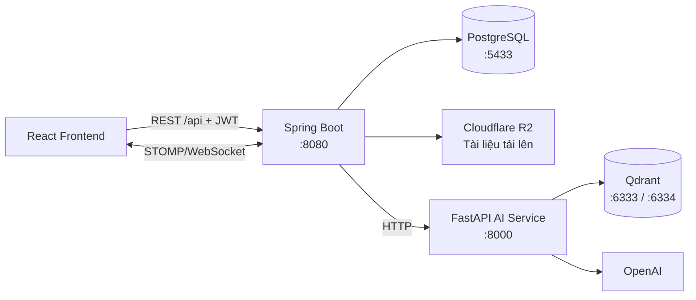
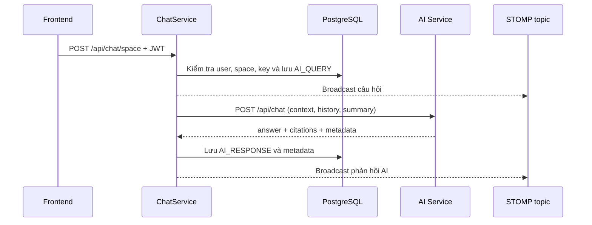

# Mora Backend

Benchmark RAG v1: [hướng dẫn chạy](../mora-ai/benchmarks/README.md), giao diện admin tại `/admin/benchmarks`.

Backend Spring Boot của Mora. Service này cung cấp REST API, xác thực JWT, WebSocket thời gian thực và điều phối dữ liệu giữa web client, PostgreSQL, lưu trữ tệp và AI Service.

## Kiến trúc hệ thống



Khi người dùng tải tài liệu, Backend lưu metadata và tệp, sau đó xử lý bất đồng bộ: gọi AI Service để phân tích PDF, chunk/index nội dung vào Qdrant. Khi chat, Backend xác thực người dùng, chuyển yêu cầu phù hợp tới AI Service và phát các sự kiện space qua WebSocket.

## Khả năng chính

- Xác thực email/mật khẩu bằng JWT, hồ sơ, avatar, đổi/khôi phục mật khẩu và chấp nhận văn bản pháp lý.
- Tạo, quản lý và tham gia Space; quản lý thành viên, lời mời và phân quyền OWNER/MEMBER.
- Tải/xóa PDF, lưu metadata và điều phối parse/index qua AI Service.
- Chat nhóm và hỏi AI trong Space; lịch sử, citation, ghim tin nhắn và typing indicator qua STOMP.
- Tạo, lấy, chấm điểm và xóa bộ ôn tập/quiz theo Space.
- Trung tâm quản trị cho Admin: dashboard vận hành, người dùng, Space và tài liệu.

## Công nghệ và thành phần

- Java 26, Spring Boot 4, Maven Wrapper.
- Spring Web MVC, Validation, Spring Data JPA, PostgreSQL và Hibernate.
- Spring Security + JWT cho xác thực; STOMP/WebSocket cho chat nhóm.
- Springdoc OpenAPI/Swagger, PDFBox, AWS SDK S3 tương thích Cloudflare R2.

```text
src/main/java/com/mora/backend/
├── controller/  # REST endpoint
├── service/     # Interface và nghiệp vụ; impl/ là hiện thực
├── repository/  # JPA repository
├── model/       # Entity và DTO request/response/event
├── security/    # JWT, UserDetails, WebSocket auth
├── config/      # Security, CORS, OpenAPI, storage, seed dữ liệu
├── client/      # HTTP client gọi AI Service
└── exception/   # Lỗi nghiệp vụ và error handler
```

## Nhóm API

API có prefix `/api`. Schema tương tác có tại `http://localhost:8080/swagger-ui.html`; OpenAPI JSON tại `http://localhost:8080/api-docs`.

| Nhóm | Ví dụ endpoint |
| --- | --- |
| Auth & tài khoản | `/api/auth/*`, `/api/users/me`, `/api/users/profile` |
| Space & lời mời | `/api/spaces`, `/api/spaces/{id}/members`, `/api/spaces/join/{inviteCode}` |
| Tài liệu | `/api/documents/upload`, `/api/documents/space/{spaceId}` |
| Chat & pin | `/api/chat/space`, `/api/chat/space/message`, `/api/chat/space/{spaceId}/pins` |
| Ôn tập | `/api/spaces/{spaceId}/study-sets`, `/api/study-sets/{id}/quiz/grade` |
| Admin | `/api/admin/dashboard`, `/api/admin/users`, `/api/admin/spaces`, `/api/admin/documents` |


## Điều phối chatbot

Backend là lớp bảo mật, lưu vết và realtime của chatbot; Frontend không gọi AI Service trực tiếp.

1. `POST /api/chat/space` xác thực JWT và kiểm tra quyền truy cập space.
2. Backend lấy các trang thuộc document được chọn, lịch sử do client gửi và bản tóm tắt hội thoại của space; sau đó lưu câu hỏi với loại `AI_QUERY` vào PostgreSQL.
3. Câu hỏi được broadcast tới `/topic/spaces/{spaceId}/messages`, rồi `AiServiceClient` gọi `POST /api/chat` của AI Service với context, history và summary. AI Service tự quản lý OpenAI key/model.
4. Khi nhận phản hồi, Backend lưu `AI_RESPONSE`, citation, câu hỏi đã cô đọng, prompt đã gửi và document đã chọn; phản hồi này lại được broadcast tới cùng topic.
5. Sau mỗi 6 phản hồi assistant trong một space, Backend kích hoạt tác vụ tóm tắt hội thoại để cập nhật context dùng ở các lượt sau.

Chat nhóm không đi qua AI: `POST /api/chat/space/message` chỉ kiểm tra quyền, lưu message và broadcast. Lịch sử được lấy qua `GET /api/chat/space/{spaceId}`; chỉ OWNER hoặc ADMIN được xóa qua `DELETE /api/chat/space/{spaceId}`.

WebSocket dùng STOMP tại `/ws`. Khi `CONNECT`, `WebSocketAuthInterceptor` xác thực JWT từ header `Authorization`; khi `SUBSCRIBE`, interceptor kiểm tra người dùng là chủ sở hữu/thành viên space hoặc admin trước khi cho phép theo dõi `/topic/spaces/{spaceId}/...`. Client cũng có thể gửi typing indicator tới `/app/spaces/{spaceId}/typing`.



Chi tiết về Router/Retrieval/Synthesis/Evaluator, RAG và fallback nằm tại [kiến trúc chatbot của AI Service](../mora-ai/README.md#kiến-trúc-chatbot).

## Yêu cầu

- JDK 26 (phiên bản được khai báo trong `pom.xml`).
- Docker và Docker Compose để chạy PostgreSQL + Qdrant local.
- AI Service đang chạy tại `http://localhost:8000` nếu dùng chức năng AI/document.

## Cấu hình môi trường

Sao chép file mẫu rồi thay giá trị thật:

```bash
cp .env.example .env
```

Các biến bắt buộc cho local:

```env
DB_URL=jdbc:postgresql://localhost:5433/mora_db
DB_USERNAME=postgres
DB_PASSWORD=postgres
```

AI cần thêm `AI_SETTINGS_ENCRYPTION_KEY` và `AI_SERVICE_INTERNAL_KEY`; key nội bộ này phải trùng với `mora-ai/.env`. Các biến tùy chọn gồm `PORT` (mặc định `8080`), `AI_SERVICE_URL` (mặc định `http://localhost:8000`) và cấu hình R2: `R2_ENDPOINT`, `R2_ACCESS_KEY`, `R2_SECRET_KEY`, `R2_BUCKET`, `R2_PUBLIC_URL`. Không commit `.env`.

Các nhóm cấu hình còn lại trong `.env.example` gồm `CORS_ALLOWED_ORIGINS`, `JWT_SECRET`, `JWT_EXPIRATION_MS`, seed admin local (`MORA_ADMIN_*`) và SMTP/khôi phục mật khẩu (`PASSWORD_RECOVERY_*`, `MAIL_*`). `JWT_SECRET` phải dài tối thiểu 32 byte.

## Chạy local

1. Khởi động PostgreSQL và Qdrant:

   ```bash
   docker compose up -d
   ```

   PostgreSQL được mở ở cổng `5433`; Qdrant dùng HTTP `6333` và gRPC `6334`.

2. Khởi động AI Service theo hướng dẫn ở [`../mora-ai/README.md`](../mora-ai/README.md).

3. Chạy Backend:

   ```bash
   chmod +x mvnw
   ./mvnw spring-boot:run
   ```

Backend sẽ lắng nghe tại `http://localhost:8080`. Schema SQL được khởi tạo tự động; Hibernate tiếp tục cập nhật schema theo cấu hình hiện tại. Swagger UI có tại `http://localhost:8080/swagger-ui.html`.

Lệnh kiểm tra/build:

```bash
./mvnw test
./mvnw clean package
```

## Chạy bằng Docker image

`Dockerfile` đóng gói riêng Backend theo multi-stage build. Hạ tầng PostgreSQL/Qdrant vẫn do `docker-compose.yml` quản lý:

```bash
docker build -t mora-backend .
docker run --env-file .env -p 8080:8080 mora-backend
```

Container cần truy cập được database, Qdrant và AI Service theo các URL đã cấu hình.

## Health check, cấu hình triển khai và Docker Compose

`GET /actuator/health/liveness` là liveness endpoint công khai cho Docker/ECS;
nó không gọi database, AI hay Qdrant. Các biến `JWT_SECRET` (tối thiểu 32 byte)
và `JWT_EXPIRATION_MS` là bắt buộc. CORS REST/WebSocket dùng
`CORS_ALLOWED_ORIGINS` (danh sách origin, phân tách bằng dấu phẩy).

Backend không còn tự tạo admin. Chỉ bật seed ở local khi đặt
`MORA_ADMIN_SEED_ENABLED=true` cùng đủ bốn biến `MORA_ADMIN_*`.

Để chạy toàn bộ Mora bằng Docker Compose, dùng repository
[`../mora-infra`](../mora-infra/README.md):

```bash
cd ../mora-infra
cp .env.example .env
docker compose --env-file .env up --build
```

## Lập lại chỉ mục OpenAI

Đặt `AI_REINDEX_ON_STARTUP=true` để chạy tác vụ backend đọc lại `document_pages` và index qua AI Service. Tác vụ báo kết quả từng tài liệu và tổng thành công/thất bại; có lỗi sẽ không hoàn tất startup. Sau khi thành công, đặt biến này về `false` và bật retrieval tại AI Service. Xem [quy trình chuyển đổi](../mora-ai/README.md#chuyển-chỉ-mục-sang-openai).

Backend không lưu hoặc truyền key/model AI của người dùng. Không còn API `/api/user/ai-settings` và kiểm tra key. Các bảng cũ được giữ nhưng ngừng sử dụng; schema mới không tạo chúng.

## Repository liên quan

- [Mora Frontend](../mora-frontend/README.md): web client, landing page, Space và khu quản trị.
- [Mora AI Service](../mora-ai/README.md): phân tích PDF, RAG, citation và ôn tập.
- [Mora Infra](../mora-infra/README.md): chạy toàn bộ stack bằng Docker Compose.


### Tài khoản chỉ dùng email

Đăng nhập nhận `{ "email": "person@example.com", "password": "..." }`; đăng ký nhận `email`, `fullName` và `password`. Thêm thành viên nhận `email` và `role`. Phản hồi tài khoản không còn account handle; chat hiển thị `fullName`, còn phản hồi thành viên có `email`.

JWT subject là user ID bất biến với `tokenVersion: 2`, vì vậy phiên cũ cần đăng nhập lại. Seed Admin nhận diện tài khoản qua `MORA_ADMIN_EMAIL`.

Trước khi triển khai từ schema cũ, hãy backup PostgreSQL và dừng Backend cũ; triển khai Frontend và Backend cùng lúc. `schema.sql` xóa cột `users.username` đã lỗi thời bằng `DROP COLUMN IF EXISTS` không kèm `CASCADE`. User ID, password hash, role và bản ghi liên quan được giữ lại; khởi động lặp lại an toàn. Vì SQL initialization tiếp tục khi có lỗi, cần xác nhận cột đã được xóa; nếu dependency ngoài chặn thao tác, xử lý rõ ràng trước khi mở lại traffic. Rollback cần bản backup vì handle đã xóa không thể khôi phục. Không chạy application context test vào database production.

## Khôi phục mật khẩu qua SMTP

Frontend có /forgot-password và /reset-password?token=..., truy cập được cả
khi đã đăng nhập. Backend cung cấp POST /api/auth/forgot-password (email) và
POST /api/auth/reset-password (token, newPassword).

Cấu hình môi trường backend (xem [.env.example](.env.example)):

    PASSWORD_RECOVERY_ENABLED=true
    PASSWORD_RECOVERY_FRONTEND_URL=https://mora.example.com
    MAIL_FROM=Mora <no-reply@example.com>
    MAIL_HOST=smtp.example.com
    MAIL_PORT=587
    MAIL_USERNAME=your-smtp-user
    MAIL_PASSWORD=your-smtp-password
    MAIL_SMTP_AUTH=true
    MAIL_STARTTLS=true
    MAIL_STARTTLS_REQUIRED=true

Dùng mật khẩu ứng dụng nếu nhà cung cấp yêu cầu. Không commit thông tin SMTP.
URL frontend là cấu hình tin cậy, không lấy từ Host header của yêu cầu.
Dùng HTTPS trong môi trường production.

Tính năng mặc định tắt: API yêu cầu khôi phục trả 503 thống nhất khi chưa bật.
Sau cấu hình, khởi động lại backend. Hãy gửi thử tới hộp thư do bạn kiểm soát,
kiểm tra cả thư rác và hoàn thành luồng trước khi mở cho người dùng.

Yêu cầu gửi email trả cùng thông báo cho email không tồn tại, tài khoản bị khóa
và email hợp lệ. Email gửi bất đồng bộ sau khi commit, có cả văn bản và HTML.
SMTP lỗi hoặc hàng đợi đầy chỉ được ghi log tổng quát, không tiết lộ tài khoản
qua API; theo dõi log “Password recovery email delivery failed” và
“Password recovery email queue is full”. Không log token hoặc nội dung email.

Liên kết có hiệu lực 30 phút, dùng một lần; mật khẩu tối thiểu 6 ký tự, tối đa
72 byte UTF-8. Server giới hạn 1 yêu cầu/email/phút, 5 yêu cầu/IP/15 phút và
20 lần đặt lại/IP/15 phút. Bộ giới hạn nằm trong bộ nhớ, giới hạn 10.000 bucket;
khởi động lại sẽ xóa hạn mức. Khi chạy nhiều instance cần rate limit dùng chung
ở proxy hoặc kho dữ liệu chung. IP dùng getRemoteAddr, không tin trực tiếp
header X-Forwarded-For; cấu hình proxy tin cậy của server nếu có reverse proxy.

Hibernate tạo bảng password_reset_tokens; cột users.credential_version có
mặc định 0, giữ tương thích JWT đang dùng. Token cũ thiếu claim này được hiểu là
0. Sau khôi phục, JWT cũ bị từ chối ở HTTP và lần kết nối WebSocket tiếp theo;
WebSocket đang mở không bị đóng chủ động trong phiên bản này. Các liên kết khôi
phục khác của tài khoản cũng bị vô hiệu hóa. Không tự đăng nhập sau đặt lại.

Có thể kiểm thử email cục bộ với Mailpit: MAIL_HOST=localhost, MAIL_PORT=1025,
MAIL_FROM=no-reply@mora.test, MAIL_SMTP_AUTH=false, MAIL_STARTTLS=false,
MAIL_STARTTLS_REQUIRED=false. Cấu hình này chỉ dành cho môi trường phát triển.
