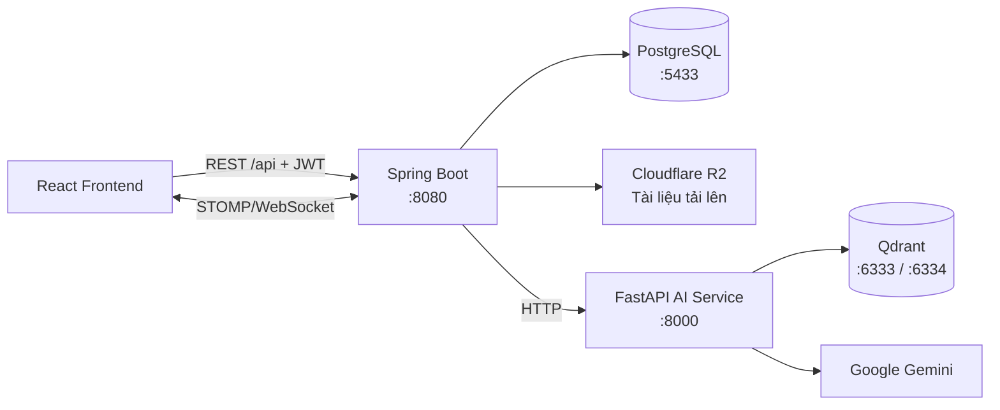
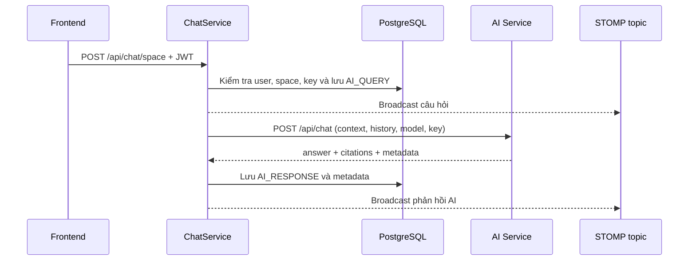

# Mora Backend

Backend Spring Boot của Mora. Service này cung cấp REST API, xác thực JWT, WebSocket thời gian thực và điều phối dữ liệu giữa web client, PostgreSQL, lưu trữ tệp và AI Service.

## Kiến trúc hệ thống



Khi người dùng tải tài liệu, Backend lưu metadata và tệp, sau đó xử lý bất đồng bộ: gọi AI Service để phân tích PDF, chunk/index nội dung vào Qdrant. Khi chat, Backend xác thực người dùng, chuyển yêu cầu phù hợp tới AI Service và phát các sự kiện space qua WebSocket.

## Công nghệ và thành phần

- Java 26, Spring Boot 4, Maven Wrapper.
- Spring Web MVC, Validation, Spring Data JPA, PostgreSQL và Hibernate.
- Spring Security + JWT cho xác thực; STOMP/WebSocket cho chat nhóm.
- Springdoc OpenAPI/Swagger, PDFBox, AWS SDK S3 tương thích Cloudflare R2.

```text
src/main/java/com/mora/backend/
├── controller/  # REST endpoint
├── service/     # Interface và nghiệp vụ; impl/ là hiện thực
├── repository/  # JPA repository
├── model/       # Entity và DTO request/response/event
├── security/    # JWT, UserDetails, WebSocket auth
├── config/      # Security, CORS, OpenAPI, storage, seed dữ liệu
├── client/      # HTTP client gọi AI Service
└── exception/   # Lỗi nghiệp vụ và error handler
```

Các nhóm API chính nằm dưới `/api`: `auth`, `users`, `documents`, `spaces`, `chat`, `admin` và `user/ai-settings`. Xem danh sách API theo code hiện hành tại Swagger: `http://localhost:8080/swagger-ui.html`.

## Điều phối chatbot

Backend là lớp bảo mật, lưu vết và realtime của chatbot; Frontend không gọi AI Service trực tiếp.

1. `POST /api/chat/space` xác thực JWT, lấy người dùng hiện tại, kiểm tra quyền thành viên của space (admin được phép) và yêu cầu người dùng đã cấu hình Gemini API key.
2. Backend lấy các trang thuộc document được chọn, lịch sử do client gửi và bản tóm tắt hội thoại của space; sau đó lưu câu hỏi với loại `AI_QUERY` vào PostgreSQL.
3. Câu hỏi được broadcast tới `/topic/spaces/{spaceId}/messages`, rồi `AiServiceClient` gọi `POST /api/chat` của AI Service với API key/model theo cài đặt người dùng.
4. Khi nhận phản hồi, Backend lưu `AI_RESPONSE`, citation, câu hỏi đã cô đọng, prompt đã gửi và document đã chọn; phản hồi này lại được broadcast tới cùng topic.
5. Sau mỗi 6 phản hồi assistant trong một space, Backend kích hoạt tác vụ tóm tắt hội thoại để cập nhật context dùng ở các lượt sau.

Chat nhóm không đi qua AI: `POST /api/chat/space/message` chỉ kiểm tra quyền, lưu message và broadcast. Lịch sử được lấy qua `GET /api/chat/space/{spaceId}`; chỉ OWNER hoặc ADMIN được xóa qua `DELETE /api/chat/space/{spaceId}`.

WebSocket dùng STOMP tại `/ws`. Khi `CONNECT`, `WebSocketAuthInterceptor` xác thực JWT từ header `Authorization`; khi `SUBSCRIBE`, interceptor kiểm tra người dùng là chủ sở hữu/thành viên space hoặc admin trước khi cho phép theo dõi `/topic/spaces/{spaceId}/...`. Client cũng có thể gửi typing indicator tới `/app/spaces/{spaceId}/typing`.



Chi tiết về Router/Retrieval/Synthesis/Evaluator, RAG và fallback nằm tại [kiến trúc chatbot của AI Service](../mora-ai/README.md#kiến-trúc-chatbot).

## Yêu cầu

- JDK 26 (phiên bản được khai báo trong `pom.xml`).
- Docker và Docker Compose để chạy PostgreSQL + Qdrant local.
- AI Service đang chạy tại `http://localhost:8000` nếu dùng chức năng AI/document.

## Cấu hình môi trường

Sao chép file mẫu rồi thay giá trị thật:

```bash
cp .env.example .env
```

Các biến bắt buộc cho local:

```env
DB_URL=jdbc:postgresql://localhost:5433/mora_db
DB_USERNAME=postgres
DB_PASSWORD=postgres
GEMINI_API_KEY=your_key
```

Các biến tùy chọn gồm `PORT` (mặc định `8080`), `AI_SERVICE_URL` (mặc định `http://localhost:8000`) và cấu hình R2: `R2_ENDPOINT`, `R2_ACCESS_KEY`, `R2_SECRET_KEY`, `R2_BUCKET`, `R2_PUBLIC_URL`. Không commit `.env`.

## Chạy local

1. Khởi động PostgreSQL và Qdrant:

   ```bash
   docker compose up -d
   ```

   PostgreSQL được mở ở cổng `5433`; Qdrant dùng HTTP `6333` và gRPC `6334`.

2. Khởi động AI Service theo hướng dẫn ở [`../mora-ai/README.md`](../mora-ai/README.md).

3. Chạy Backend:

   ```bash
   chmod +x mvnw
   ./mvnw spring-boot:run
   ```

Backend sẽ lắng nghe tại `http://localhost:8080`. Schema SQL được khởi tạo tự động; Hibernate tiếp tục cập nhật schema theo cấu hình hiện tại.

Lệnh kiểm tra/build:

```bash
./mvnw test
./mvnw clean package
```

## Chạy bằng Docker image

`Dockerfile` đóng gói riêng Backend theo multi-stage build. Hạ tầng PostgreSQL/Qdrant vẫn do `docker-compose.yml` quản lý:

```bash
docker build -t mora-backend .
docker run --env-file .env -p 8080:8080 mora-backend
```

Container cần truy cập được database, Qdrant và AI Service theo các URL đã cấu hình.
